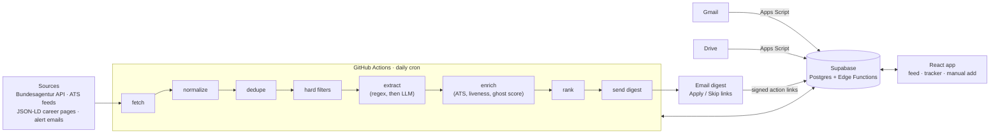

# jobsignal

A personal job-search system with two parts:

1. **A daily job feed.** Every morning it fetches new postings, removes duplicates, filters out roles that don't fit, scores how likely each one is to be a ghost job, and emails a short ranked list with one-tap **Apply** / **Skip** actions.
2. **An application tracker that maintains itself.** Each application's status comes from the emails that arrive: confirmations, rejections and interview invitations update the right application with no manual logging.

It runs on free tiers only: GitHub Actions, Supabase, Google Apps Script, and free LLM API tiers.

> **Status:** Phase 1 (daily feed from the Bundesagentur API, plain email digest) is live. See the [roadmap](#roadmap).

## Architecture



## Design decisions

- **Rules before the LLM.** Filters, regex extractors and email classification rules run first. An LLM sees only what code can't parse, so most postings and emails never reach a model, and every result is cached by content hash.
- **Generic parsers only.** Sources are public APIs, ATS job-board feeds, and schema.org `JobPosting` JSON-LD. A site that doesn't work with a generic technique is dropped, not given a custom scraper. No LinkedIn scraping.
- **Status from events, not a status column.** Applications have an append-only event log (`applied`, `interview_invited`, `rejected`, ...). The current status is a view over the latest event, so history is never lost and an email can't overwrite a manual entry.
- **Ghost-job score.** Each posting gets a 0–100 score built from explainable signals: found only on aggregators, reposts, posting age, evergreen wording, how specific the description is. Every signal and its points are stored, and the digest shows the reasons.
- **Free-tier LLM routing.** One provider interface with fallthrough on rate limits, plus per-stage privacy rules: public job descriptions may go to free tiers, personal email never does.
- **Survive neglect.** Each source fails on its own without stopping the run, a dead-man's switch catches a pipeline that silently stops, and stale applications expire automatically.

## Results

Precision@10 (the share of surfaced jobs marked Apply) and the skip-reason distribution will be published here once there are a few weeks of labels.

## Running it

```bash
python3 -m venv .venv && source .venv/bin/activate
pip install -r requirements-dev.txt
brew install gitleaks                   # or see github.com/gitleaks/gitleaks
pre-commit install                      # gitleaks secret check on every commit

cp pipeline/config/profile.example.yaml pipeline/config/profile.yaml   # edit; it's gitignored
python -m pipeline.run --dry-run
pytest
```

In GitHub Actions, the profile comes from the `PROFILE_YAML` repository secret.

## Repository layout

```
pipeline/     Python daily pipeline (sources, extraction, enrichment, ranking, delivery)
supabase/     SQL migrations and Edge Functions
web/          React front end (from Phase 2)
apps-script/  Gmail and Drive bridge (from Phase 5)
tests/
```

## Roadmap

| Phase | Scope |
|---|---|
| 0 | Repo, Supabase project, scheduled dry run |
| 1 | Feed MVP: Bundesagentur source, dedupe, hard filters, plain email digest |
| 2 | Feed UI and one-tap triage (Apply / Skip with reasons) |
| 3 | LLM extraction, ranking, precision@10 |
| 4 | Application tracking from events |
| 5 | Inbox automation: email classification and matching |
| 6 | More sources: ATS feeds, JSON-LD, company discovery |
| 7 | Enrichment: ATS detection, liveness, ghost score |
| 8 | CV parse checks, outreach |
| 9 | Tuning, Telegram delivery |
